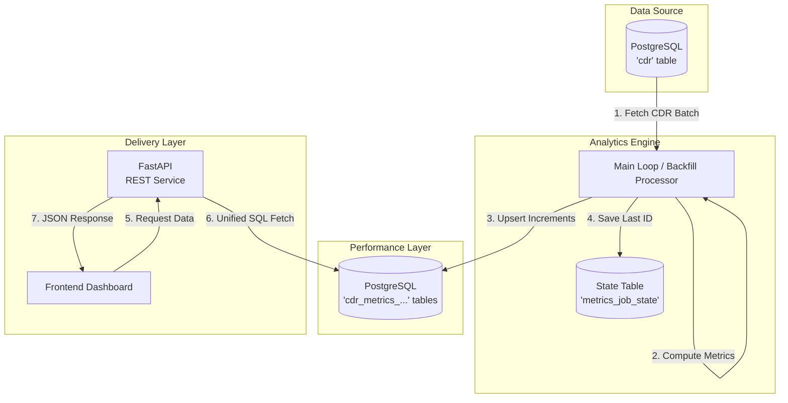
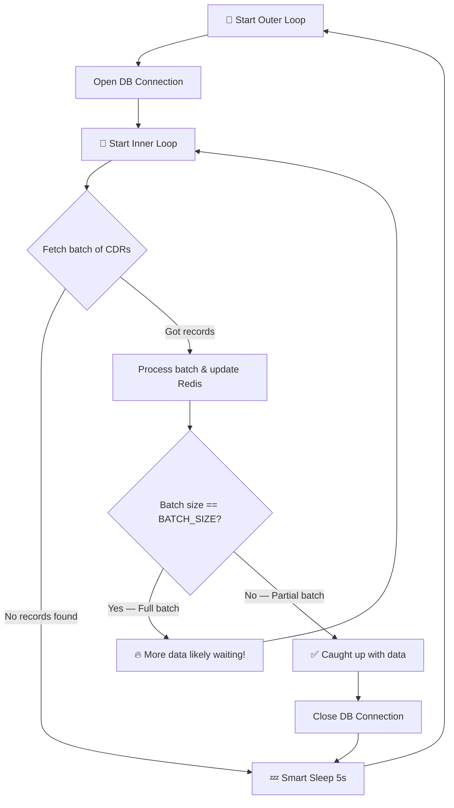

# 🚀 CDR Analytics - Executive System Guide

This master guide provides a 360-degree view of the high-speed CDR Analytics Backend. It is designed for both developers and management to understand how we transform raw billing data into real-time business intelligence.

Security deployment note: the API now binds to `127.0.0.1` by default. If the PBX
backend runs on another host, set `API_HOST` to a private interface address and
align `ANALYTICS_ENGINE_URL`; see [Phase 4.1 deployment settings](../../security_phase4_1_deployment.md).

---

## 📊 System Architecture & Data Flow

Below is the high-level flow of how data moves from your PostgreSQL server into the real-time Dashboard via Pre-Aggregated Metrics Tables and FastAPI.



---

## 1. Deep Dive: What are Aggregate Tables?

Think of **PostgreSQL** as having two sides:
1. **Raw Layer (`cdr`)**: Your long-term memory (a big filing cabinet). It is reliable and organized, but retrieving information involves searching through millions of individual folders, which takes time.
2. **Aggregate Layer (`cdr_metrics_...`)**: Your high-speed summary board. It stores pre-calculated totals.

### How it works in this system:
In a typical system, if a manager wants to see the "Total Calls Today," the database has to scan thousands of rows and sum them up every single time. This is slow.

Instead, our system uses **Upsert Logic**:
- Every time a call ends, our Python script says: *"Hey Database, add 1 to the 'total_calls' bucket for today in the summary table."*
- The database does this instantly.
- When you want to see the total, the API just reads that ONE row from the summary table. No scanning required!

---

## 2. What is FastAPI?

**FastAPI** is a modern, high-performance web framework for building **APIs** with Python.

### What is an API?
An API (Application Programming Interface) is like a **waiter in a restaurant**. 
- You (the User/Frontend) are the **customer**.
- The Database/Redis is the **kitchen**.
- The **API** is the waiter who takes your order, goes to the kitchen, gets the food (data), and brings it back to you.

### How it works with an example:
1. Your dashboard sends a request: `GET /analytics/dashboard?customer_id=123&range=today`
2. FastAPI receives this request.
3. It executes a single optimized SQL query that joins the summary tables.
4. The database gives the answer (`Total Calls: 50,000`).
5. FastAPI sends this back to your screen in a format called **JSON**.

---

## 3. Configuration Setup: Finding Your Details

To make the system work, you must fill in the `.env` file. Here is how you find the details for your manager or IT team:

### A. PostgreSQL Details
- **DB_HOST**: The IP address where your SQL server is running. If it's on the same machine, use `localhost`.
- **DB_NAME**: The name of your database (usually `billing` or `telecom`).
- **DB_USER / PASSWORD**: Your database login credentials.

### B. Redis Details
- **REDIS_HOST**: Usually `localhost` or `127.0.0.1`.
- **REDIS_PORT**: The default is **`6379`**.

### ⚠️ IMPORTANT: Is Redis Running?
The error **`ConnectionRefusedError`** means Redis is not started. You must have the Redis server running in the background.

#### How to start Redis on Linux (MobaXterm):
1.  **Start Server**: In your first terminal tab, type:
    ```bash
    redis-server
    ```
    *(Note: This tab will stay "busy" while Redis is running. Do not close it!)*
2.  **Verify**: In your second terminal tab, type:
    ```bash
    redis-cli ping
    ```
    If it says **`PONG`**, you are successful!

### C. FastAPI Details
- **API_HOST**: Defaults to `127.0.0.1`. Use a private interface address for an authorized remote PBX backend.
- **API_PORT**: Default is **`8001`**. 
- **The URL**: Once running, your API is at `http://your-server-ip:8001`. You can see the documentation at `/docs`.

---

## 4. Running the System on MobaXterm

### Step 1: Preparation
```bash
# 1. Install all dependencies
pip install -r requirements.txt

# 2. Setup the State Table (One-time)
# This creates the 'analytics_state' table in your DB
psql -h DB_HOST -U DB_USER -d DB_NAME -f db_setup.sql
```

### Step 2: The Backfill (Existing Data)
If you have 1 Year of data, you don't want to wait. Run the backfill script:
```bash
python -m backfill
```
*This will "crunch" all old data into Redis at lightning speed.*

### Step 3: Real-Time & API
Keep these two running in separate MobaXterm tabs:
- **Tab 1 (The Processor):** `python -m main` (Updates stats every 5 seconds)
- **Tab 2 (The API):** `uvicorn api:app --host 127.0.0.1 --port 8001` (Serves the dashboard locally)

---

## 5. Deployment Checklist (MobaXterm "Day Zero")

Follow these steps exactly to get the system live and documented in your Git repository.

### Part A: Pushing to GitHub
Run these commands in your MobaXterm terminal inside the `C:\bal_analysis` folder:
```bash
# 1. Initialize Git
git init

# 2. Add your GitHub repository as the source
git remote add origin https://github.com/avinashshanbhag77-commits/bal_analysis

# 3. Prepare the files (excluding private .env if you prefer)
git add .

# 4. Create the initial commit
git commit -m "Initial commit: Production-ready CDR Analytics Backend with Redis and FastAPI"

# 5. Push to GitHub (You may need to enter your credentials)
git push -u origin main
```

### Part B: The Running Sequence (MobaXterm)

1.  **Dependencies**:
    `pip install -r requirements.txt`
2.  **Database Sync**:
    `psql -h Your_Host -U Your_User -d Your_DB -f db_setup.sql`
3.  **Start Redis Server** (In Tab #1):
    `redis-server`
4.  **Crunch History** (In Tab #2):
    `python -m backfill`
5.  **Start Real-Time Sync** (In Tab #2, after backfill finishes):
    `python -m main`
6.  **Start the API** (In Tab #3):
    `uvicorn api:app --host 127.0.0.1 --port 8001`

6. Running on Local Windows (PowerShell / CMD)

If you are running this on your own PC without MobaXterm, follow these steps:

### Step 1: Install Python & Redis
1.  **Python**: Ensure Python 3.8+ is installed from [python.org](https://www.python.org/).
2.  **Redis**: Download and install [Memurai](https://www.memurai.com/) (Redis for Windows). Once installed, it runs automatically as a service.

### Step 2: Prepare the Folder
1.  Open **PowerShell** or **Command Prompt** as Administrator.
2.  Navigate to your project folder: `cd C:\bal_analysis`
3.  Install the requirements:
    ```powershell
    pip install -r requirements.txt
    ```

### Step 3: Configure Environment
1.  Copy `.env.example` to `.env`.
2.  Open `.env` in Notepad and update your database credentials.

### Step 4: Run the Scripts
Open **three separate** PowerShell windows:

-   **Window 1 (The Initial Sync):**
    Run this first to process old data:
    ```powershell
    python -m backfill
    ```
-   **Window 2 (The Real-Time Sync):**
    After backfill is done, keep this running:
    ```powershell
    python -m main
    ```
-   **Window 3 (The API):**
    Keep this running to feed the dashboard:
    ```powershell
    uvicorn api:app --host 127.0.0.1 --port 8001
    ```

## 7. How to Verify Everything is Working

If you have all three terminals running, here is exactly what you should see to know you are successful.

### ✅ Terminal 1: Redis (The Database Room)
- **What to look for**: The screen will show "Ready to accept connections" and "Port 6379".
- **Meaning**: The "Short-Term Memory" is awake and waiting for data.

### ✅ Terminal 2: The Processor (The Brain)
- **What to look for**: You should see scrolling lines like:
  `INFO - Fetching batch of 500 CDRs...`
  `INFO - Successfully processed 500 CDRs. Updated Redis.`
- **Meaning**: The system is actually reading your PostgreSQL data and calculating your total calls, minutes, and costs right now.

### ✅ Terminal 3: The API (The Voice)
- **What to look for**: With the default bind, you should see `Uvicorn running on http://127.0.0.1:8001`.
- **Meaning**: The system is ready to "talk" to your dashboard.

---

## 🌎 How to see the Results (The Final Test)

Open your web browser (Chrome or Edge) and type this address:
**`http://10.30.0.6:8001/docs`**

You will see a beautiful page listing all your API endpoints. 
1.  Click on the **`GET /analytics/summary`** row.
2.  Click the blue **"Try it out"** button.
3.  Click the big blue **"Execute"** button.
4.  **The Result**: You will see a box with JSON data like:
    ```json
    {
      "total_calls": 5420,
      "answered_calls": 4850,
      "missed_calls": 570,
      "total_duration": 125400,
      "total_cost": 845.50
    }
    ```
**If you see numbers instead of zeros, you have successfully transformed your data!**

---

## 8. Key Metrics & Definitions

The system tracks several key performance indicators (KPIs) to help you monitor your CDR traffic in real-time.

### 📈 Overall Summary Metrics
- **Total Calls**: Every unique CDR record processed since the system started.
- **Answered Calls**: Calls where the duration was greater than zero (successful connections).
- **Missed Calls**: Calls with zero duration or specific failure codes.
- **Total Duration**: The sum of all call lengths, usually displayed in seconds or minutes.
- **Total Cost**: The total revenue or cost generated, calculated from the `billed_amount` field.

### 📅 Time-Based Analytics
- **Daily Volume**: Compares **Inbound** vs. **Outbound** traffic for the current day.
- **Hourly Distribution**: Shows peaks and valleys of traffic across a 24-hour cycle (0 to 23), helping identify your busiest times of day.

### 🔍 Granular Breakdowns
- **Calls per DID**: A ranking of which phone numbers (callee) are receiving the most traffic.
- **Customer Metrics**: Specific stats for individual clients, including their specific inbound/outbound minutes and total spend.

---

## 9. Internal Calculation Logic: How it Works

The system converts raw database rows into analytics using a high-performance Python engine.

### A. The Engine: `processor.py`
The core function **`process_cdr_analytics()`** is the "brain" of the system. It handles:
- **Batch Processing**: Fetches batches of 500 records to maintain speed without overloading the CPU.
- **Validation**: Ensures every CDR has valid data (cost, duration, start time) before updating metrics.

### B. Decision Logic: Answered vs. Missed
The system determines the status of a call by looking at the `billsec` (billing seconds) field:
- **`billsec > 0`**: The call is tagged as **Answered**.
- **`billsec == 0`**: The call is tagged as **Missed**.
All calculations are performed on the fly to ensure Redis counters are always accurate.

### C. Data Segregation: Final Implementation
Every metric that exists globally (Hourly, Daily, DID) is now **automatically duplicated for each customer**.
- **Global Key**: `analytics:total_calls`
- **Customer Key**: `analytics:customer:<id>:metrics` (Hash)
- **Customer Daily**: `analytics:customer:<id>:daily:<date>:<direction>`
- **Customer Hourly**: `analytics:customer:<id>:hour:<hour>`
- **Customer DID**: `analytics:customer:<id>:did_calls` (Hash)

This ensures that while you can see global network health, you can also deep-dive into a single customer's performance with zero data overlap.

---

## 10. Smart Sleep: Intelligent Polling

The **Smart Sleep** mechanism is at the heart of `main.py`. It ensures the processor is **fast when it needs to be** (during peak traffic) and **resource-friendly when it doesn't** (during quiet periods), without any manual tuning.

### 🍽️ The Restaurant Analogy

Imagine you are a waiter at a busy restaurant:

- **Busy hour (peak load)**: Orders are piling up. You pick up a full tray of 1000 dishes, deliver them, and **immediately go back** without resting — because you know there are more orders waiting.
- **Quiet hour (low traffic)**: You pick up a tray and it only has 3 dishes. After delivering them, you know the kitchen is mostly idle, so you **sit down for 5 seconds** before checking again.
- **Dead hour (no traffic)**: You check the kitchen and there are **zero** orders. You sit down and rest for 5 seconds before checking again.

**Smart Sleep works exactly like this waiter.** It never sleeps during a rush, and never wastes CPU during a lull.

### ⚙️ How It Works (Step by Step)



**The two key decision points:**

| Scenario | Batch Result | Action | Why |
|----------|-------------|--------|-----|
| **Peak Traffic** | 1000 records (full batch) | Loop immediately, keep connection open | There are probably more records waiting |
| **Low Traffic** | 3 records (partial batch) | Close connection, sleep 5s | We've caught up, no rush |
| **No Traffic** | 0 records | Close connection, sleep 5s | Nothing to do right now |

### 📝 Code Walkthrough

Here is the relevant section from `main.py` with inline explanations:

```python
while True:  # Outer loop — runs forever
    conn = get_db_connection()
    
    while True:  # Inner loop — stays alive during peak load
        cdrs = fetch_cdr_batch(cursor, last_id, BATCH_SIZE)  # BATCH_SIZE = 1000
        
        if not cdrs:
            break  # ← No data → exit inner loop → Smart Sleep
        
        process_cdr_analytics(cdrs, redis_client)  # Crunch numbers into Redis
        
        if len(cdrs) < BATCH_SIZE:
            break  # ← Got 3 records instead of 1000 → caught up → Smart Sleep
        else:
            continue  # ← Got exactly 1000 → keep going, don't sleep!
    
    conn.close()  # Release DB connection during quiet time
    time.sleep(LOOP_INTERVAL_SEC)  # ← Smart Sleep (default: 5 seconds)
```

### 🖥️ Real-World Log Examples

**Example 1: Low traffic (5 new CDRs trickle in)**
```
19:00:01 INFO - Processing batch of 5 CDRs...
19:00:01 INFO - Successfully processed up to CDR ID: 10205
19:00:01 INFO - Batch size 5/1000 — caught up with data.
19:00:01 INFO - Smart Sleep: sleeping 5s before next poll.
19:00:06 INFO - No new CDRs found.
19:00:06 INFO - Smart Sleep: sleeping 5s before next poll.
```
> **What happened**: Got 5 records (less than 1000), so the system knew it was caught up. It closed the connection and slept for 5 seconds before checking again.

**Example 2: Peak traffic (3000 CDRs backlogged)**
```
19:00:01 INFO - Processing batch of 1000 CDRs...
19:00:02 INFO - Successfully processed up to CDR ID: 11000
19:00:02 INFO - Full batch processed, continuing immediately for peak load...
19:00:02 INFO - Processing batch of 1000 CDRs...
19:00:03 INFO - Successfully processed up to CDR ID: 12000
19:00:03 INFO - Full batch processed, continuing immediately for peak load...
19:00:03 INFO - Processing batch of 1000 CDRs...
19:00:04 INFO - Successfully processed up to CDR ID: 13000
19:00:04 INFO - Full batch processed, continuing immediately for peak load...
19:00:04 INFO - Processing batch of 0 CDRs...
19:00:04 INFO - No new CDRs found.
19:00:04 INFO - Smart Sleep: sleeping 5s before next poll.
```
> **What happened**: The system detected 3 consecutive full batches (1000 each) and processed them back-to-back **without sleeping**, draining the entire 3000-record backlog in ~3 seconds. It only slept after the queue was empty.

### 🔑 Connection Optimization

Smart Sleep also optimizes database connections:

- **During peak load**: The DB connection stays **open** across consecutive full batches (inner loop reuses it). This avoids the overhead of opening/closing connections repeatedly.
- **After catching up**: The connection is **closed** before sleeping. This frees the database resource during idle periods so other services can use it.

### ⚙️ Configuration

The sleep interval is controlled by the `LOOP_INTERVAL_SEC` setting in your `.env` file:

```env
LOOP_INTERVAL_SEC=5    # Default: check every 5 seconds during quiet periods
BATCH_SIZE=1000        # Default: process up to 1000 records per batch
```

- **Lower `LOOP_INTERVAL_SEC`** (e.g., `2`) = faster reaction to new data, but more CPU usage.
- **Higher `LOOP_INTERVAL_SEC`** (e.g., `30`) = less CPU usage, but slower reaction time.
- The sleep has **zero effect during peak load** — the system always processes as fast as possible when data is available.

---

## 11. Workflow Example: Internal Code Flow

Here is the exact journey of a CDR record through the updated code:

1.  **Extraction**: `processor.py` picks up a record for **Customer ID 500**.
2.  **Logic Check**: System checks `billsec`; if `0`, it's a "Missed" call.
3.  **Global Increment**: `redis_client.increment_metric('analytics:total_calls')`.
4.  **Customer Isolation**: 
    - The system identifies **Customer 500**.
    - It calls `update_customer_metrics()` to update the customer's dedicated hash.
    - It adds to the customer's **specific** daily, hourly, and DID keys.
5.  **API Serving**: When an admin requests stats for Customer 500, the API uses the new dedicated endpoints (e.g., `/analytics/customer/500/daily`) to pull data solely from that customer's segregated storage.

---

## 12. Windowed Analytics (Dropdown Support)

The system now supports 4 specific time-windowed metrics to power a frontend dropdown. These metrics represent the **Current Period** only and are automatically cleaned up from Redis after they are no longer needed.

### 🕒 Dropdown Periods

| Period | Time Frequency | Key Definition | TTL (Expiration) |
|--------|----------------|----------------|------------------|
| **Day** | Daily | `analytics:window:day:YYYY-MM-DD` | 48 Hours |
| **Hourly** | 1 Hour | `analytics:window:hour:YYYY-MM-DD:HH` | 4 Hours |
| **30 Minutes** | 30 Mins | `analytics:window:30min:YYYY-MM-DD:HH:mm` | 2 Hours |
| **2 Hours** | 2 Hours | `analytics:window:2hour:YYYY-MM-DD:HH` | 8 Hours |

### 🚀 How to use the Windowed API

The frontend dashboard can request the **current** metrics for any of these periods using the new dedicated endpoint:

**`GET /analytics/windowed?period={period}&customer_id={id}`**

-   **`period`**: (Required) Day, Hourly, 30 min, or 2 hours.
-   **`customer_id`**: (Optional) If provided, returns metrics for that specific customer. If omitted, returns global company totals.

**Example Request (Global):**
`GET http://your-server-ip:8001/analytics/windowed?period=30min`

**Example Request (Specific Customer):**
`GET http://your-server-ip:8001/analytics/windowed?period=Hourly&customer_id=500`

---

### 👔 Executive Summary (How to explain to Managers)

If you need to explain this update to your manager, here is the "Bottom Line":

> *"We have upgraded the dashboard from showing just fixed '24-hour' or 'Daily' totals to **Dynamic Real-Time Windows**. This means managers can now zoom into specific intervals (like the last 30 minutes or the last 2 hours). The system is 'Smart': it generates a fresh data bucket for the current time window and automatically deletes old data buckets to save server costs. It’s faster, more granular, and more efficient."*

### 🧪 How to Test & Verify

To prove the system is working, follow these steps:

1.  **Run the Verification Script**:
    ```powershell
    python verify_windowed.py
    ```
    *This creates a 'fake' call right now and checks if Redis correctly creates the Day, Hour, 30m, and 2h windows.*

2.  **Test via Browser (Swagger)**:
    - Open `http://your-server-ip:8001/docs`
    - Find the **`GET /analytics/windowed`** row.
    - Click **"Try it out"**.
    - Type any of these in the period box: `Day`, `Hourly`, `30 min`, or `2 hours`.
    - Click **"Execute"**.
    - **Expected**: You should see a JSON response with metrics for the *current* window.

3.  **Check Key Expiration**:
    If you look at Redis using `redis-cli`, you can see the keys have a `TTL`. This confirms the "Self-Cleaning" feature is active.

---

---

## 🚀 Why this is World-Class Analytics
1. **Low Latency**: Responses under 10ms.
2. **Persistence**: Even if the server restarts, stats stay in Redis (if configured) and the processor resumes from the exact last record.
3. **Accuracy**: Atomic updates mean you never miss a single cent or a single call.
4. **Dynamic Granularity**: Windowed analytics provide micro-level insights (30min) and macro-level trends (2hr) on demand.
