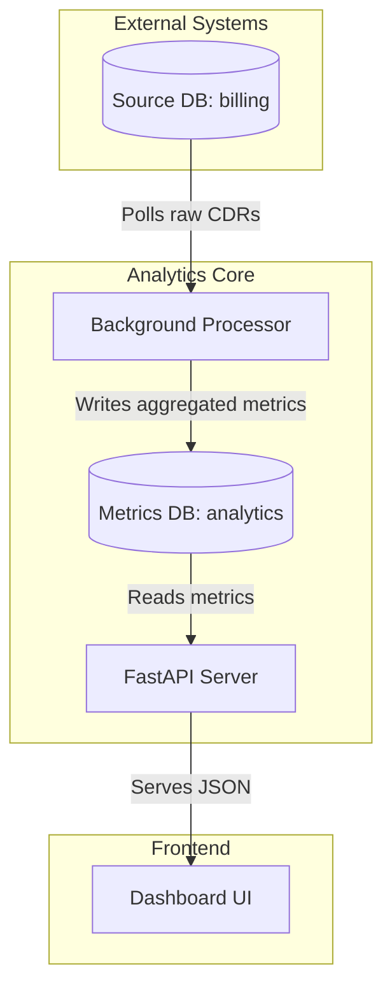

# System Architecture

The CDR Analytics system follows a modern ETL (Extract, Transform, Load) pattern combined with a microservices-inspired process management strategy.

## Data Flow Diagram

## Key Components

### 1. Dual-DB Separation
To prevent analytical queries from slowing down the primary billing operations, the system uses two distinct databases:
- **Source DB**: The read-only source of original CDR data.
- **Metrics DB**: A specialized store where data is pre-aggregated and optimized for dashboard queries.

### 2. Background Processor (`processor.py` & `main.py`)
A continuous loop that:
1. Checks the `metrics_job_state` table in the Metrics DB to find the last processed ID.
2. Fetches a batch of new CDRs from the Source DB.
3. Groups and aggregates the records in-memory.
4. Updates the daily, hourly, and DID-based tables in the Metrics DB.
5. Advances the checkpoint ID in a single transaction.

### 3. Dashboard API (`api.py`)
A FastAPI application that provides a unified view of the metrics:
- Fetches all required dashboard components (KPIs, trends, distributions) in a single complex SQL query using Common Table Expressions (CTEs).
- Returns the data in a flat JSON structure ready for frontend charting libraries.

### 4. Process Management
The system is managed via a single entry point (`main.py`) which uses Python's `multiprocessing` to start and monitor both the Processor and the API server as separate OS-level processes.
